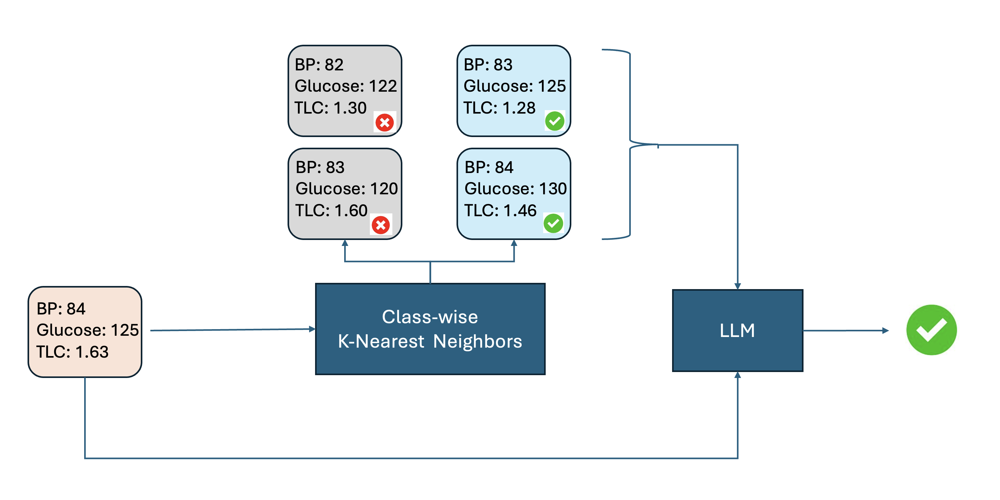

# C-RAIL: Contrastive Retrieval-Augmented In-Context Learning

Code, outputs and paper materials for **C-RAIL**, a method for using LLMs as classifiers on
medical data with class imbalance.


**Paper:** *Contrastive Retrieval Augmented In-Context Learning for Medical Classification Tasks with Imbalanced Data* (Swarnika Joshi, Kshitij S. Jadhav)

📄 [Published Paper (IEEE Xplore)](https://ieeexplore.ieee.org/document/11416461) | [PDF](paper/C-RAIL.pdf)

## Idea

LLMs can classify via in-context learning: put a few labelled examples in the prompt. In
**RAIL** (Retrieval-Augmented In-Context Learning) those examples are the test patient's nearest
neighbours. On imbalanced medical data the neighbours are mostly the majority (negative) class,
which biases the model towards predicting negative.

**C-RAIL** retrieves nearest neighbours *from each class separately* and puts both sets in the
prompt, so the model always sees similar positive and similar negative cases.



## Layout

| Path | Contents |
|---|---|
| `notebooks/01_rail.ipynb` | RAIL on the clinical cohort* |
| `notebooks/02_c_rail.ipynb` | C-RAIL on the clinical cohort* |
| `notebooks/03_rail_d.ipynb` | RAIL on the public diabetes dataset |
| `notebooks/04_c_rail_d.ipynb` | C-RAIL on the public diabetes dataset |
| `notebooks/05_cart_baseline.ipynb`, `06_reasoning_inference.ipynb` | Zero-shot / reasoning-style inference on the clinical cohort* |
| `data/` | Public diabetes dataset (`diabetes.csv`, plus a 50-row subset) |
| `outputs/` | Per-patient predictions, confidence and rationale (Llama 3.1 8B, diabetes) |
| `paper/` | Paper PDF, figures, talk and poster slides |
| `reports/` | Related abstract and slides |

\* The clinical cohort is private patient data and is **not** included, so notebooks 01, 02, 05
and 06 cannot be run as-is (their saved outputs were cleared). 03 and 04 are fully runnable.

## Quickstart

```bash
python -m venv .venv && source .venv/bin/activate
pip install -r requirements.txt
cp .env.example .env        # then set OPENAI_API_KEY in .env
jupyter lab notebooks/
```

Inference uses the OpenAI API through `langchain-openai`. The model is set by `MODEL` in each
notebook's configuration cell (default `gpt-4o-mini`). Your key is read from the
`OPENAI_API_KEY` environment variable and is never stored in the repo. Running the notebooks
makes paid API calls, one per patient.

## Results in `outputs/` (Llama 3.1 8B, diabetes, n = 768)

Computed directly from the prediction files:

| Method | Accuracy | Precision | Recall | F1 |
|---|---|---|---|---|
| Zero-shot | 0.658 | 0.506 | 0.780 | 0.614 |
| RAIL | 0.684 | 0.537 | 0.679 | 0.600 |
| C-RAIL | 0.669 | 0.517 | 0.787 | 0.624 |

C-RAIL gives the best recall and F1 and RAIL the best accuracy and precision. These are a single
run of one model; see the paper for the full evaluation. The files were produced with a locally
hosted Llama model, not the OpenAI default above, so re-running with `gpt-4o-mini` will give
different numbers.

## Citation

See [`CITATION.cff`](CITATION.cff).
